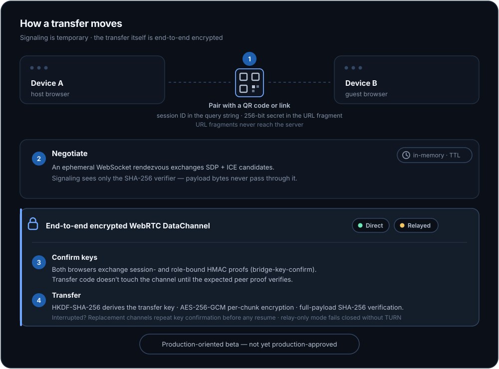
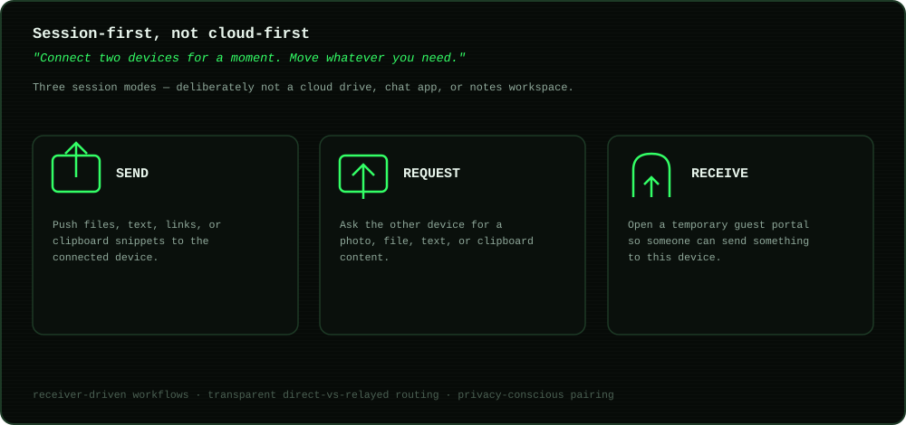

# Bridge

A temporary browser-to-browser device bridge for moving files, text, links, and clipboard snippets without accounts or permanent cloud storage.

  

  

## Product thesis

**Connect two devices for a moment. Move whatever you need.**

Bridge is deliberately not a cloud drive, chat app, or notes workspace. The core jobs are:

1. **Send** — push files/text/links to a connected device.
2. **Request** — ask another device for a photo, file, text, or clipboard content.
3. **Receive** — open a temporary guest portal so someone can send something to this device.

### TV display mode

Open Bridge on a TV browser with `?tv=1` and it becomes a living-room receiver: the pairing QR and session code render at reading distance, the screen stays awake while the session is open, and transfers from the paired device are received and saved automatically (a remote has no cheap way to answer a per-file prompt; pairing with the session secret is the consent). Anything too large for the browser-memory receive limit still asks, with the reason stated. The mode is remembered per browser, `?tv=0` turns it off, and the phone or laptop on the other side needs nothing special — it scans the TV's code as usual.

## Why this project exists

Existing products such as PairDrop, LocalSend, FilePizza, Wormhole, and Send Anywhere already prove that browser and local-device transfer is useful. Bridge differentiates on receiver-driven workflows, transparent direct-vs-relayed routing, privacy-conscious pairing, and a simple session-first UX.

## Architecture

- Frontend: TypeScript + Vite PWA
- Signaling: small ephemeral WebSocket rendezvous service
- Transfer: authenticated WebRTC DataChannel
- NAT traversal: STUN with TURN fallback and optional relay-only privacy mode
- Security: 256-bit QR secret, signaling verifier separation, application-level key confirmation, HKDF-derived AES-256-GCM transfer keys, full-payload SHA-256 verification, a production signaling Origin allowlist that fails closed when missing, non-HTTPS, or loopback, and hard startup ceilings for operator-tunable signaling resource/rate controls
- Storage: no normal transfer payload storage on the signaling service
- Large files: chunked sender streaming with backpressure, pluggable receive sinks, direct-to-disk streaming where supported, bounded in-memory fallback, and verified-boundary resume across replacement DataChannels
- Resilience: bounded WebRTC recovery, ICE restart, transfer cancellation/timeouts, and explicit signaling/socket failure states

See [docs/PLAN.md](docs/PLAN.md), [docs/ARCHITECTURE.md](docs/ARCHITECTURE.md), [docs/SIGNALING_LIMITS.md](docs/SIGNALING_LIMITS.md), and [docs/RELEASE_REVIEW.md](docs/RELEASE_REVIEW.md).

## Release status

Bridge is a production-oriented beta, not yet a production-approved deployment. Repository-side security, resilience, accessibility automation, local TURN verification, release artifact integrity, and deployment runbooks are implemented, but final dependency-backed validation and genuine manual accessibility checks are still release gates. Production hosting, signaling/TURN endpoints and credentials, exact origin/CSP configuration, and the deployed smoke test are operator inputs and are intentionally not committed.

When the signaling runtime is started with `NODE_ENV=production`, `SIGNAL_ALLOWED_ORIGINS` is mandatory, every configured browser origin must use HTTPS, and loopback origins are rejected. Local/test runs may still omit the allowlist or use localhost so repository integration tests and localhost development remain explicit non-production modes. Numeric signaling resource/rate overrides also have reviewed hard maxima; values above those ceilings fail startup rather than silently weakening the intended abuse boundary.

Bridge CI and Bridge Deploy are currently manual-only to avoid noisy GitHub Actions failures before runner execution. They must remain isolated to Bridge paths and never build or deploy sibling projects.

## Repository history

Bridge was extracted from the Creative-Experiments monorepo, where it previously lived under `bridge/` alongside sibling projects (`colortrace/`, `extensible-terminal/`). This repository now contains only Bridge; the workflows remain at `.github/workflows/bridge.yml` and `.github/workflows/bridge-deploy.yml`, and `scripts/verify-isolation.mjs` is kept as a canary (see the comment in that file) rather than removed.

---

*Built by [Hans Sai](https://builtbysai.com).*
